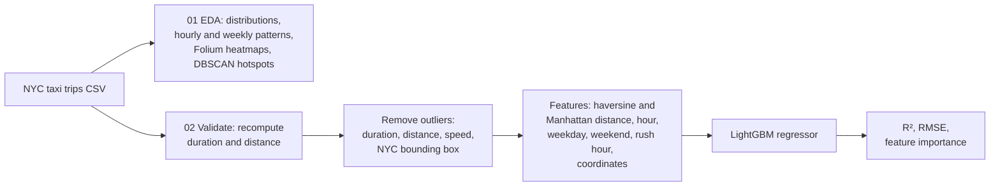

# NYC Taxi Trip Duration: Analysis and Prediction

**How long will a New York taxi ride take? Geospatial EDA on 730k trips, then a LightGBM model that explains 77% of the variance in trip duration from where, when and how far.**

[](https://colab.research.google.com/github/dojedaro/nyc-taxi-trip-duration-analysis-and-prediction/blob/main/01_eda_geospatial_analysis.ipynb)
[](https://colab.research.google.com/github/dojedaro/nyc-taxi-trip-duration-analysis-and-prediction/blob/main/02_trip_duration_prediction.ipynb)
[](https://github.com/dojedaro/nyc-taxi-trip-duration-analysis-and-prediction/actions/workflows/notebooks.yml)

## Results

| | Value |
|---|---|
| Model | LightGBM regressor, 50 trees, learning rate 0.1 |
| Split | 80/20 random, seed 42 |
| R² on the test split | **0.768** |
| RMSE on the test split | **311 s** (about 5 minutes) |
| Rows removed as outliers | 9,071 (1.24%) |

Most-used features (LightGBM split counts): **pickup hour** (419), **haversine distance** (198),
Manhattan distance (17), rush-hour flag (12). Time of day matters as much as distance: the same
3 km takes very different times at 8 a.m. and 3 a.m.

**Caveats:** outliers (impossible speeds, zero distances, trips outside NYC) were removed from the
whole dataset before splitting, so the test set is cleaned too and the RMSE is somewhat optimistic
for raw production traffic. The model is deliberately small (50 trees, no tuning), so this is a
baseline rather than a ceiling.

### A data bug worth noting

The prediction notebook checks its inputs before trusting them. On this copy of the dataset the
`distance` column was missing, so it recomputes distance with the haversine formula, and it also
recomputes duration from the timestamps, replacing columns that disagree. Validating inputs
explicitly like this is what catches silent data problems in production pipelines.

## How it works



- **`01_eda_geospatial_analysis.ipynb`:** distributions of duration, distance and speed; trip volume
  and duration by hour and weekday; pickup and dropoff heatmaps with Folium; pickup hotspots
  clustered with DBSCAN; interactive Plotly views.
- **`02_trip_duration_prediction.ipynb`:** input validation, outlier filtering, feature engineering
  and the LightGBM model.

## Run it

Download the NYC taxi trip duration dataset (the Kaggle competition data) and save it as
`nyc_taxi_trip_duration.csv` next to the notebooks.

```bash
pip install -r requirements.txt
jupyter notebook 01_eda_geospatial_analysis.ipynb
```

## Stack

Python, pandas, NumPy, LightGBM, scikit-learn, Folium, Plotly, seaborn, Matplotlib.

## Limitations and next steps

- Split before filtering outliers, and report the error on unfiltered test trips as well.
- Predict `log(duration)`, the usual target for this skewed variable, and tune the model with
  cross-validation.
- Add weather and holiday features, and a time-based split (train on earlier months, test on later)
  to measure how the model holds up over time.

## License

MIT
